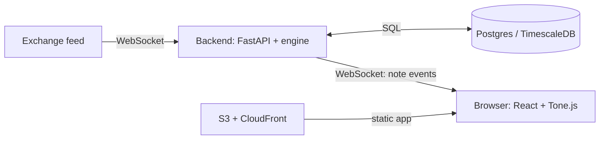

# Volatone

> **Status:** **Active Work-in-Progress (Autumn 2026)**
> This repository is an ongoing personal project focused on merging high-performance systems engineering with algorithmic music theory. Under active construction (WIP 🙏)

Volatone is a real-time data translation framework designed to ingest high-frequency market data (or any pseudo-Brownian signal) and algorithmically transform order book dynamics into live, multi-instrument musical compositions.

Rather than simply mapping a lagging closing price to a basic sound graph, this project aims to sonify the underlying **market behavior, liquidity depth, and order book velocity**. The end goal is to interpret these financial microstructural patterns through the rulesets of harmonic music theory, and *(hopefully)* make some pleasant-sounding music from the madness.

## Rough architecture



## Stack _(TBD)_
| Area | Choice |
| --- | --- |
| Backend | Python 3.12, FastAPI, Pydantic |
| Frontend | React, TypeScript, Vite |
| Database | PostgreSQL (TimescaleDB) |
| Tooling | uv, ruff, mypy, pytest, ESLint, Prettier, Vitest |
| Delivery | Docker Compose, GitHub Actions, AWS (EC2, S3, CloudFront) |

## Quick start

Requires Python 3.12+, [uv](https://docs.astral.sh/uv/), Node 22+, and Docker.

```bash
cp .env.example .env
make install
docker compose up db -d     # start the database
make dev-backend            # terminal 1: API on http://localhost:8000
make dev-frontend           # terminal 2: app on http://localhost:5173
```

Run `make help` for all commands. _API docs (TBD)_
